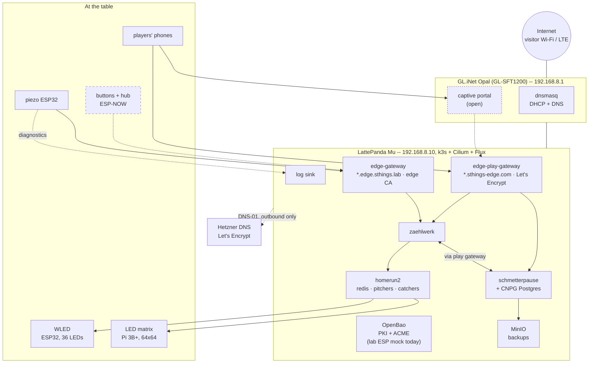
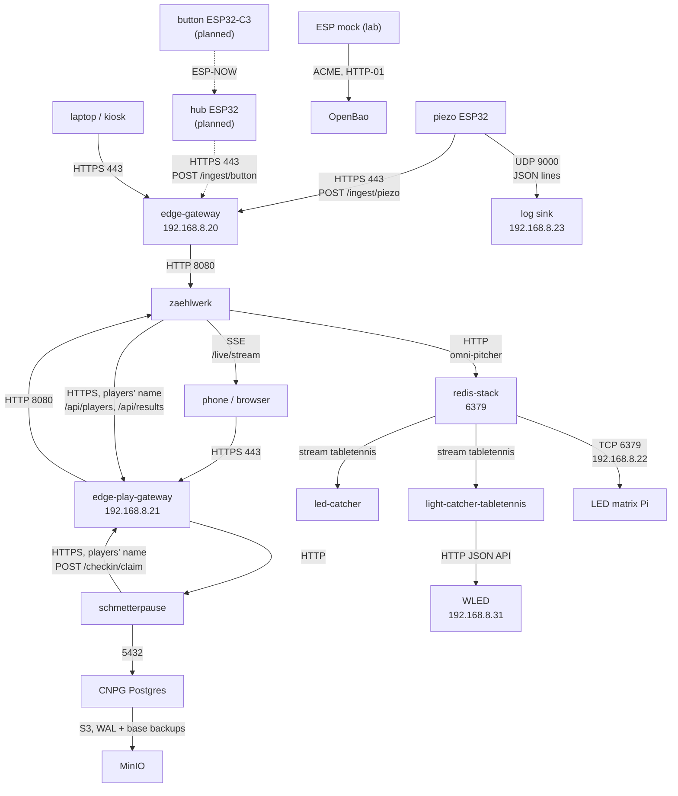
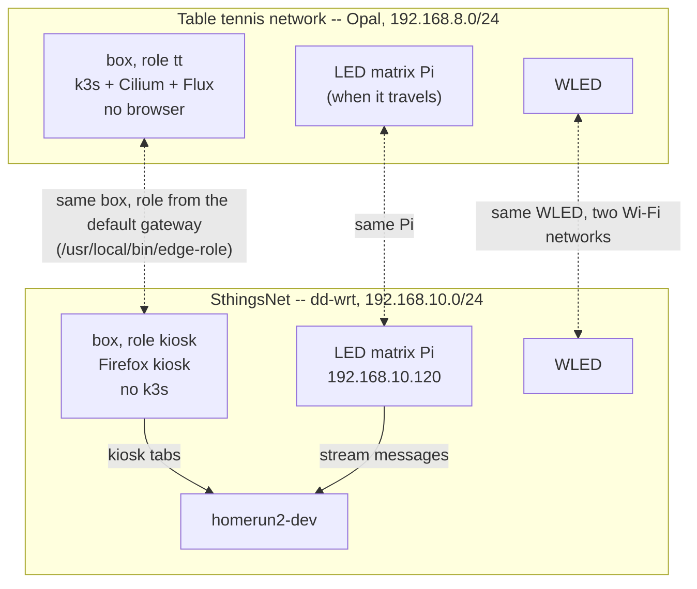

# The table tennis landscape -- today and the target

One page for the whole thing: the router, the box, the services on it, the
boards and screens around it, and who talks to whom on which port. **Solid**
lines and boxes run today, **dashed** ones are planned, and anything marked
**open** is not decided yet. The details stay where they are: the site, the
cluster and the two name worlds in [architecture.md](./architecture.md), the
box step by step in
[`clusters/sthings-edge/README.md`](https://github.com/stuttgart-things/harvester/blob/main/clusters/sthings-edge/README.md), the
rules of each service in its own ADRs.

Update this page in the same pull request that changes what it shows.

## Context

- **The box is the only server.** Everything that keeps state runs on it; the
  router is the network and the name service, nothing more.
- **Two gateways, two name worlds.** Devices and admin UIs use
  `*.edge.sthings.lab` with the edge CA; players use `*.sthings-edge.com` with
  a publicly trusted certificate, so a phone needs nothing installed.
- **zaehlwerk owns the running match**, schmetterpause owns players, results
  and ratings. They talk over HTTPS in both directions -- players and pairings
  to zaehlwerk, won matches and phone check-ins back -- and deliberately
  through the **players'** names: the same links then work on a phone, and the
  Let's Encrypt certificate is in trust-manager's bundle anyway.
- **homerun2 is the bus to the lights.** zaehlwerk pitches onto the
  `tabletennis` stream; the led-catcher and the light-catcher pick it up. No
  table tennis logic in either catcher.

## Ports and protocols

| From | To | Port / protocol | Address | TLS |
|---|---|---|---|---|
| piezo ESP32 | zaehlwerk `/ingest/piezo` | HTTPS 443 | `zaehlwerk.edge.sthings.lab` → `.20` | edge root CA, checked on the board |
| hub ESP32 *(planned)* | zaehlwerk `/ingest/button` | HTTPS 443 | `zaehlwerk.edge.sthings.lab` → `.20` | edge root CA |
| button ESP32-C3 *(planned)* | hub | ESP-NOW (no IP) | hub MAC, same Wi-Fi channel | -- |
| piezo ESP32 | log sink | UDP 9000, JSON lines | `192.168.8.23` | none (diagnostics only) |
| ESP mock *(lab only)* | OpenBao ACME | HTTPS, HTTP-01 | `openbao.<edge domain>` | edge root CA |
| phones | schmetterpause | HTTPS 443 | `schmetterpause.sthings-edge.com` → `.21` (router answers locally) | Let's Encrypt |
| phones | zaehlwerk page, SSE `/live/stream` | HTTPS 443 | `zaehlwerk.sthings-edge.com` → `.21` | Let's Encrypt |
| admin, kiosk | zaehlwerk, homerun2 UIs, OpenBao, MinIO | HTTPS 443 | `*.edge.sthings.lab` → `.20` | edge root CA |
| zaehlwerk | schmetterpause `/api` | HTTPS 443, bearer token | `schmetterpause.sthings-edge.com` → `.21` (pods resolve through the Opal) | Let's Encrypt, in trust-manager's bundle |
| schmetterpause | zaehlwerk `/checkin/claim` | HTTPS 443, bearer token | `zaehlwerk.sthings-edge.com` → `.21` | Let's Encrypt |
| zaehlwerk | homerun2 | HTTP to the omni-pitcher, or Redis 6379 | in-cluster | -- |
| LED matrix Pi | redis-stack | TCP 6379, password | `192.168.8.22` | -- |
| light-catcher-tabletennis | WLED | HTTP JSON API | `192.168.8.31` | -- |
| schmetterpause | Postgres (CNPG) | TCP 5432 | in-cluster | CNPG's own |
| CNPG | MinIO | S3 | in-cluster | -- |
| cert-manager | Hetzner DNS, Let's Encrypt | HTTPS 443, **outbound only** | public | public |

The fixed addresses all sit outside the Opal's DHCP range `.100-.249`:
`.1` router, `.10` box, `.20` gateway, `.21` players, `.22` Redis for the
matrix, `.23` log sink, `.31` WLED.

## Two networks, two roles of the box

The box, the matrix and the WLED move between the two networks without being
reconfigured: the box picks its role from the default gateway, the WLED keeps
both Wi-Fi networks, and the matrix reads from whichever Redis its network
offers.

## Today and the target

| | Today | Target | Where it is tracked |
|---|---|---|---|
| Box on the Opal | runs: k3s, Cilium, Flux, gateways, OpenBao, MinIO (2026-10-12) | -- | [box README](https://github.com/stuttgart-things/harvester/blob/main/clusters/sthings-edge/README.md), harvester#364 |
| Piezo board | reports over HTTPS, edge root checked on the board | -- | zaehlwerk-firmware |
| Buttons | not built | ESP-NOW buttons to a hub, the hub reports to zaehlwerk | zaehlwerk-firmware#2, #3 |
| Device certificates | OpenBao ACME runs (HTTP-01, no EAB); only the lab's ESP mock enrols, the piezo board trusts the edge root but has no certificate of its own | boards enrol themselves; EAB per device + static leases | [architecture.md](./architecture.md), *Internal* |
| Players reach schmetterpause | join `sthings-edge`, open the URL | **open**: a captive portal that sends them there | not decided -- needs an issue / ADR |
| Kiosk | role `kiosk` in SthingsNet only | -- | [box README](https://github.com/stuttgart-things/harvester/blob/main/clusters/sthings-edge/README.md), step 7 |

### Open: a captive portal

Not decided, and nothing is built. What a decision has to answer:

- **Where it runs.** On the Opal (openNDS or the portal of the GL firmware --
  keeps the box out of the path, but the router has little memory and the GL
  firmware must stay), or as a service on the box behind the players' gateway
  (one place for everything, but the router still has to redirect to it).
- **What it is for.** Only a landing page that points at schmetterpause, or a
  gate in front of the uplink.
- **What it must not break.** The boards, the matrix and the WLED join the
  same Wi-Fi without a browser -- they must pass untouched (by MAC or by a
  separate SSID). And the players' certificate is publicly trusted only for
  `*.sthings-edge.com`: the portal page has to live on that name, or phones
  show a certificate warning.
